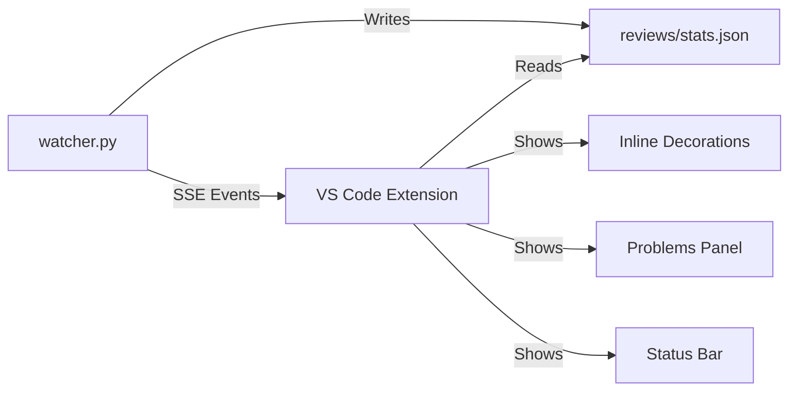

# VS Code Extension Plan

## 🧠 Brainstorm Summary

### Context
Build a VS Code extension that displays AI code review feedback inline, integrating with the existing Local CodeRabbit watcher infrastructure.

---

## Architecture Options Evaluated

| Option | Description | Effort | Verdict |
|--------|-------------|--------|---------|
| **A: SSE Client** | Connects to existing watcher | Low | ✅ **SELECTED** |
| B: Standalone | Own Z.AI client in extension | High | ❌ Duplicates code |
| C: Hybrid | Both modes | Very High | ❌ Over-engineered |

---

## ✅ Recommended Architecture: SSE Client



**Why this approach:**
1. Reuses existing `watcher.py` SSE server (port 8765)
2. Single source of truth for reviews
3. Extension stays lightweight (~500 lines)
4. Faster to build (4-6 hours vs 8+)

---

## Implementation Plan

### Phase 1: Scaffold (30 min)
- [ ] Create extension using `yo code`
- [ ] Set up TypeScript configuration
- [ ] Add package.json commands and activation events

### Phase 2: SSE Connection (1 hour)
- [ ] Create `src/sseClient.ts` - EventSource wrapper
- [ ] Handle connection/reconnection logic
- [ ] Parse incoming review events

### Phase 3: Diagnostics (1.5 hours)
- [ ] Create `src/diagnosticsProvider.ts`
- [ ] Map review issues to VS Code Diagnostic objects
- [ ] Register DiagnosticCollection for Problems panel
- [ ] Add severity mapping (CRITICAL → Error, WARNING → Warning)

### Phase 4: Inline Decorations (1.5 hours)
- [ ] Create `src/decorationProvider.ts`
- [ ] Define decoration types (red squiggly, yellow, blue)
- [ ] Apply decorations on file open/change
- [ ] Add hover messages with issue details

### Phase 5: Status Bar (30 min)
- [ ] Create `src/statusBar.ts`
- [ ] Show connection status (🟢 Connected / 🔴 Disconnected)
- [ ] Show issue count badge
- [ ] Click to open Problems panel

### Phase 6: Commands (30 min)
- [ ] `localCodeRabbit.connect` - Manual connect
- [ ] `localCodeRabbit.disconnect` - Disconnect
- [ ] `localCodeRabbit.showDashboard` - Open dashboard in browser

---

## File Structure

```
vscode-extension/
├── package.json
├── tsconfig.json
├── src/
│   ├── extension.ts        # Entry point
│   ├── sseClient.ts        # SSE connection
│   ├── diagnosticsProvider.ts
│   ├── decorationProvider.ts
│   ├── statusBar.ts
│   └── types.ts            # Shared interfaces
└── README.md
```

---

## Configuration

```json
{
  "localCodeRabbit.serverUrl": "http://localhost:8765",
  "localCodeRabbit.autoConnect": true,
  "localCodeRabbit.showInlineDecorations": true
}
```

---

## Verification Checklist

- [ ] Extension activates on workspace open
- [ ] Connects to watcher SSE server
- [ ] Shows issues in Problems panel
- [ ] Displays inline squiggly decorations
- [ ] Status bar updates with connection state
- [ ] Reconnects automatically on disconnect

---

## Effort Estimate

| Phase | Time |
|-------|------|
| Scaffold | 30 min |
| SSE Connection | 1 hour |
| Diagnostics | 1.5 hours |
| Decorations | 1.5 hours |
| Status Bar | 30 min |
| Commands | 30 min |
| **Total** | **5.5 hours** |

---

## Next Steps

1. Run `/create vscode-extension` to generate scaffold
2. Implement phases sequentially
3. Test with running watcher
